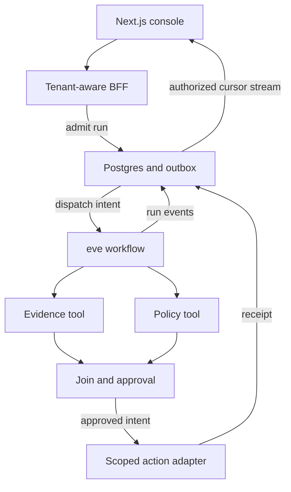
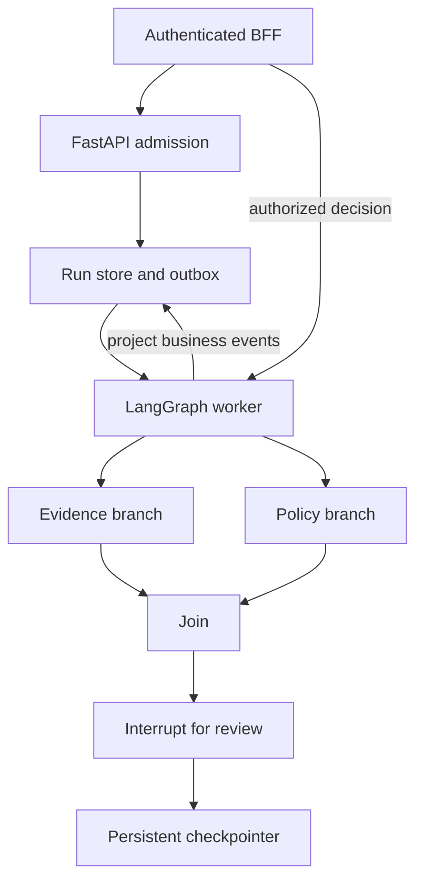
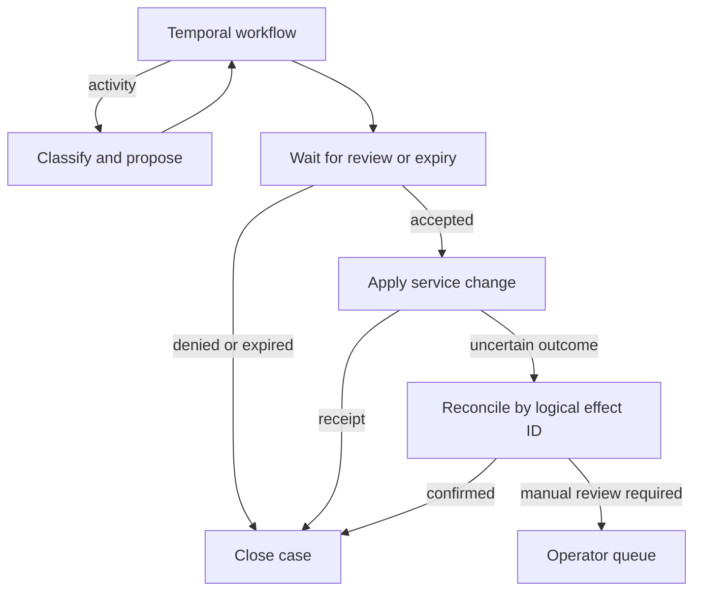

# Choose a stack by workload

## Three complete profiles

| Decision | A · Vercel operator console | B · Python casework | C · Long-running enterprise process |
|---|---|---|---|
| Best fit | A small TypeScript team wants a browser-accessible control room and managed execution | Domain logic depends on Python, explicit branching, evidence retrieval and checkpoint inspection | A process spans days, systems, human decisions and auditable external writes |
| Client | Next.js, shadcn/ui, React Flow, Motion, TanStack Table | Same client and public event contract | Existing enterprise shell or Next.js and a review queue |
| API / entry | Next.js server routes, authenticated via enterprise OIDC | FastAPI behind same-origin BFF | Domain service admits a case and starts a durable workflow |
| Run owner | eve on Workflow SDK | LangGraph + persistent checkpointer in a hosted worker | Temporal workflow, with model and tool calls in activities |
| Model and tools | AI SDK provider via approved gateway, tool schemas in Zod | Pydantic models and tool adapters; optional scoped retrieval with pgvector | Bounded model task for classification or drafting; deterministic service activities for writes |
| Persistence | Postgres business state, tenant run-event log, approvals, effect ledger | Postgres business state plus checkpoint storage; object storage for evidence | Temporal history for process recovery, Postgres for business read models and effect receipts |
| Delivery | Vercel frontend and managed workflow service; database and model in approved regions | Web frontend plus separately hosted Python worker, private database and evidence store | Web/API, Temporal service or approved managed environment, independently versioned workers |
| Telemetry / eval | OTel, prompt and workflow versions, Promptfoo acceptance dataset | OTel plus optional Langfuse evaluation datasets | OTel linked to workflow and activity IDs, outcome and reconciliation tests |
| Cost driver to measure | Long-lived streams, workflow steps, model tokens, sandbox sessions | Worker concurrency, checkpoint writes, model calls, evidence retrieval | Workflow history growth, activity volume, worker capacity and operational ownership |
| First proof | Disconnect browser during approval, return, approve once, inspect receipt | Restart worker at a checkpoint, resume in same thread, inspect both evidence branches | Kill worker after external success before acknowledgment, recover without applying the change twice |
| Switch when | Explicit Python graph semantics or private hosting become hard constraints | Multi-day cross-service compensations dominate the model work | A short read-only assistant can meet the need with a single bounded tool loop |

[eve](https://eve.dev/) · [LangGraph](https://docs.langchain.com/oss/python/langgraph/overview) · [Temporal](https://docs.temporal.io/) · [Vercel function limits](https://vercel.com/docs/functions/limitations)

## A · TypeScript on Vercel

Admit a run and outbox intent in one transaction. The dispatcher uses the stable run ID to start the workflow or reconcile an uncertain start. A run handle and event cursor reach the browser immediately. The browser may close between any two events. Match stream duration, buffering, reconnect and data residency to the selected hosting plan. Install the desk's typed adapter around documented eve events and tool boundaries; the internal wire format is independent of the public event contract. [eve release](https://vercel.com/blog/eve-is-now-generally-available) · [Outbox](https://docs.aws.amazon.com/prescriptive-guidance/latest/cloud-design-patterns/transactional-outbox.html)

## B · Python with explicit state

Scope a thread ID to the tenant and business run. Branch results use stable keys, so a retried branch cannot append a second copy. On interrupt, release the worker slot. Resume only after checking the reviewer, proposal hash, expiry and version. LangGraph resumes the node from its beginning when an interrupt is continued; isolate earlier side effects in idempotent tasks or separate nodes. Store enough input and model metadata to audit a result. [Interrupt semantics](https://docs.langchain.com/oss/python/langgraph/interrupts) · [Durable execution](https://docs.langchain.com/oss/python/langgraph/durable-execution)

## C · Durable cross-service execution

Use one workflow ID per case. Use a signal or update for human decisions. Schedule retries and timeouts at the activity boundary. A timed-out write can still have succeeded at the destination. Persist its logical effect key before sending it, pass that key to the receiving API and reconcile against a receipt before retrying. If the destination cannot deduplicate or report status, route the uncertain write to a human. Define an explicit compensating operation only when the business operation allows it. [Temporal activities](https://docs.temporal.io/activity-definition) · [Failure detection](https://docs.temporal.io/develop/typescript/failure-detection) · [Example of receiver-side idempotency](https://docs.stripe.com/api/idempotent_requests)

## A simpler starting point

For a read-only assistant with a small set of tools, start with a bounded AI SDK or OpenAI Agents SDK loop, a server-side authorization check per tool, a deadline and structured results. Add durable workflow ownership when a run must survive process loss, a human wait, or external side effects. Add specialists when their inputs, tools or evaluation criteria genuinely differ. Evaluate the multi-agent route against the same cases using a single-agent baseline. [AI SDK agents](https://ai-sdk.dev/docs/agents/overview) · [OpenAI Agents SDK](https://openai.github.io/openai-agents-python/)
